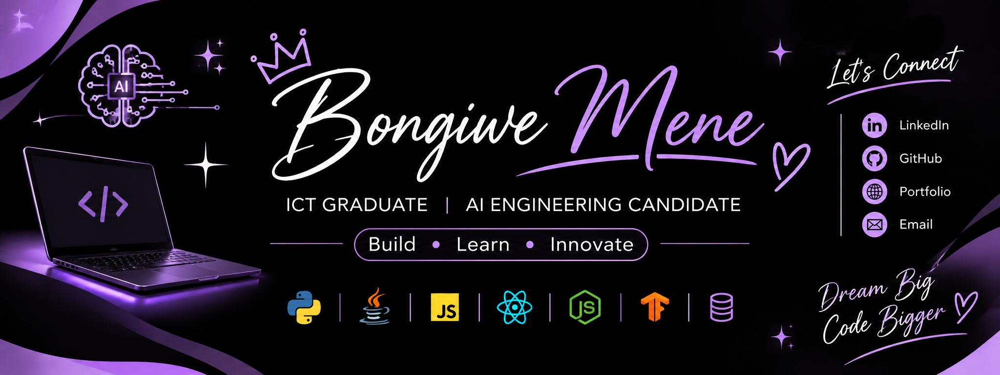

  

# Hi, I'm Bongiwe! 👋

### Building, learning and exploring the world of technology.

---

## ✨ About Me

I'm an ICT graduate specialising in Application Development and currently an **AI Engineering Candidate at CAPACITI** based in South Africa.

I enjoy building applications, exploring artificial intelligence and using technology to solve practical problems. I'm continuously learning, experimenting with new tools and turning ideas into working projects.

- 🎓 National Diploma in ICT: Application Development
- 🤖 Currently developing my AI Engineering skills
- 💻 Interested in Software Development, Machine Learning and Deep Learning
- 🔐 Exploring Cybersecurity and Cloud Technologies
- 🌱 Always learning and building something new

---

## 🛠️ Technologies & Tools

**Languages**

**Web Development**

**AI & Data**

**Tools & Databases**

---

## 🚀 Featured Projects

### 🚛 TruckGuard AI
An AI-powered fleet safety and risk-monitoring application designed to help identify driver risks and support safer fleet operations.

**Built with:** Python · Streamlit · Random Forest · Folium

[View Project](https://github.com/BongiweMene/TruckGuard)

### ❤️ Heart Disease Risk Predictor
A machine learning application that analyses health-related inputs to estimate heart disease risk.

**Built with:** Python · Scikit-learn · Streamlit

### 👁️ VisualQC
A computer vision application exploring image analysis and classification.

**Built with:** Python · OpenCV · CNN · MobileNetV2 · TensorFlow/Keras

### 🎫 Aspire AI
An AI-powered ticket management platform designed to streamline IT support workflows.

### 📦 Inventory Management System
A Java desktop application for managing inventory records using database operations.

---

## 📊 GitHub Overview

---

## 🤝 Let's Connect

I'm always happy to connect with people in technology, collaborate on projects and explore new opportunities.

- 💼 Portfolio: https://professional-portfol-rqik.bolt.host
- 📧 Email: menebongiwe3@gmail.com
- 🐙 GitHub: https://github.com/BongiweMene
- 💼 LinkedIn: https://www.linkedin.com/in/bongiwe-mene-8b1528242/

**Thanks for visiting my GitHub!**

